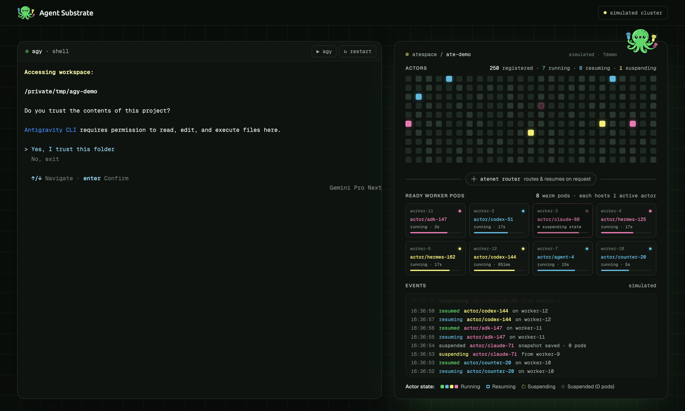

# ate-env-demo

An [ate.dev](https://ate.dev/)-style demo page: a real shell on the left for
running the Antigravity CLI (`agy`) or Claude Code (`claude`), and the `atespace / …` cluster
visualization on the right, driven live by your Agent Substrate cluster.



```sh
npm install
npm start            # http://127.0.0.1:3000
```

- **Sessions**: each tab is a login `$SHELL` in its own PTY, streamed to
  xterm.js over a WebSocket. **+** opens a tab running agy or Claude Code,
  Alt+T opens one running the current tab's agent, Alt+W closes it, and Alt+1…9
  switches between tabs.
- **One actor per session**: each tab gets a UUID session ID. Its shell exports
  `AGY_SESSION_ID`, `ATE_ACTOR` (same value), `ATE_ATESPACE`,
  `ATE_ACTOR_TEMPLATE`, `ATE_CONTEXT`, `ATE_ENDPOINT`, and `AGY_MODEL`, then
  starts `HOME="$AGY_HOME" agy --model "$AGY_MODEL" --settings "$AGY_SETTINGS"` or
  `claude --mcp-config "$CLAUDE_MCP_CONFIG" --append-system-prompt "$CLAUDE_SESSION_PROMPT" --allowedTools "$CLAUDE_ALLOWED_TOOLS"`
  with no initial prompt. The
  visualization outlines actors owned by open tabs and labels them with the
  tab name.
- **Per-session MCP server**: each tab's agent gets an `env` server for that
  session, and instructions to use its `read_file`,
  `write_file` and `shell` tools for all file and shell work. Both agents may
  call those tools without asking: agy through a `mcp(env/*)` allow rule
  in `--settings`, Claude Code through `--allowedTools`. agy only reads MCP
  servers from `~/.gemini/config/mcp_config.json` and global rules from
  `~/.gemini/GEMINI.md`, so agy tabs get a temporary `$AGY_HOME` that symlinks
  everything in your home except those files. Its copies add the session's
  server and instructions to yours. Claude Code tabs get a temporary MCP config
  file and the instructions as `--append-system-prompt`. Both are deleted when
  the tab closes. Agents reach the server through `/mcp/<session>` on the demo
  server, which forwards to `AGY_MCP_URL` and runs `ate-env suspend <session>`
  after each tool call, once no other call for that session is in flight. The MCP tools come from
  the cluster's [env](https://github.com/agent-substrate/env) deployment: the
  server keeps `kubectl port-forward -n ate-system svc/ate-env-api 7777:7777` open
  for the selected cluster and runs `ate-env create <session>` for each tab, so
  `/v1alpha/envs/<session>/mcp` has an environment behind it.
- **Cluster**: the server polls `kubectl ate get actors -A -o json` and the
  `WorkerPool` CRs. To avoid kubectl-ate's per-call port-forward (2–10s), it
  keeps one `kubectl port-forward -n ate-system svc/api` open and passes `--endpoint`.
- **Cluster picker**: the navbar dropdown lists your kubeconfig contexts
  (GKE ones grouped by project). Picking one points every `kubectl` call and
  the port-forward at that context, without changing your kubeconfig's
  current-context, and restarts open tabs so their sessions use it.
- **Fallback**: if the cluster is unreachable, the page runs a simulated cluster
  like ate.dev's. Force it with `/?demo`.

| env | default | |
| --- | --- | --- |
| `PORT` / `HOST` | `3000` / `127.0.0.1` | The shell runs as you, so only bind to localhost. |
| `KUBE_CONTEXT` | current-context | Cluster to start on. |
| `ATESPACE` | all | Limit to one atespace. |
| `AGY_ACTOR_ATESPACE` | `$ATESPACE` or `ate-ant` | Atespace for session actors. |
| `AGY_ACTOR_TEMPLATE` | | Actor template for session actors, exported as `ATE_ACTOR_TEMPLATE`. |
| `AGY_MODEL` | `gemini-3.8-flash-medium` | Model passed to `agy --model` (see `agy models`). |
| `AGY_MCP_URL` | `http://localhost:7777/v1alpha/envs/{session}/mcp` | Per-session MCP server the demo server forwards to; `{session}` is the session UUID. Empty disables it. |
| `AGY_MCP_NAME` | `env` | Name of that server in agy and Claude Code. |
| `ENV_API_SVC` / `ENV_PF_PORT` | `ate-system/svc/ate-env-api:7777` / `7777` | env API port-forward target. |
| `ATE_ENV` | `ate-env` | `ate-env` CLI used to create each session's environment. |
| `DEMO_CWD` | this repo | Working directory for the shell and agents. |
| `DEMO_SHELL` | `$SHELL` | Shell to spawn. |
| `POLL_MS` | `1000` | Delay between cluster polls. |
| `ATE_ENDPOINT` | | Use an existing ate-api endpoint instead of the built-in port-forward. |
| `ATE_PORT_FORWARD` | `1` | `0` lets kubectl-ate manage its own tunnels. |
| `ATE_API_SVC` / `ATE_PF_PORT` | `ate-system/svc/api:443` / `18443` | Port-forward target. |
